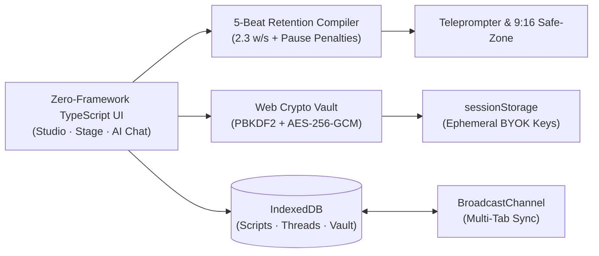

# Absurd Low-Poly Studio

[](https://github.com/dr-week/absurd-lowpoly-content-engine/actions/workflows/deploy-pages.yml)
[](https://github.com/dr-week/absurd-lowpoly-content-engine/actions/workflows/sync-trends.yml)

**Live Demo:** [https://dr-week.github.io/absurd-lowpoly-content-engine/](https://dr-week.github.io/absurd-lowpoly-content-engine/)

A **local-first, zero-backend content creation studio** for 1998 PS1/N64 ultra low-poly absurdist Indian comedy shorts, retention-engineered 5-beat scripts, and 9:16 creator tooling.

---

## Preview

| Desktop Studio (1440×900) | Mobile Studio (375×812) |
| :---: | :---: |
|  |  |

---

## Problem → Architecture → Trade-offs

- **Problem:** Short-form creators need fast script pacing math, teleprompter rehearsal, and 9:16 safe-zone checks without leaking API keys or waiting on cloud round-trips.
- **Architecture:** Zero-framework modular TypeScript (`<150` lines per module) backed by **IndexedDB** (`scripts`, `chat_threads`, `vault`, `profiles`), **`BroadcastChannel`** multi-tab sync, and **Web Crypto (`PBKDF2` + `AES-256-GCM`)** for client-side BYOK key storage.
- **Trade-offs:** Choosing local-first IndexedDB + `sessionStorage` ephemeral keys eliminates backend hosting costs and server-side key exposure, at the trade-off of per-browser state (mitigated by `navigator.storage.persist()` and JSON export).

---

## System Data Flow



---

## Quantified Engineering Metrics

- **0ms Local Compile Latency:** Deterministic 5-beat script compilation (`hook → setup → escalation → climax → loop`) runs synchronously in-browser.
- **Modular Architecture:** Zero-framework TypeScript modules kept under ~150 lines each for maintainability and tree-shaking.
- **Lean Production Bundle:** Core CSS (`~7.6 kB` gzip) and core engine JS (`~4.5 kB` gzip) with route-level code splitting for Stage (`~3.7 kB` gzip) and Chat (`~6.2 kB` gzip).

---

## Quick-Start Local Dev

```bash
# Install dependencies
npm --prefix web install

# Start Vite dev server
npm --prefix web run dev

# Run TypeScript check + production build
npm --prefix web run build

# Run Vitest unit tests
npm --prefix web test
```
