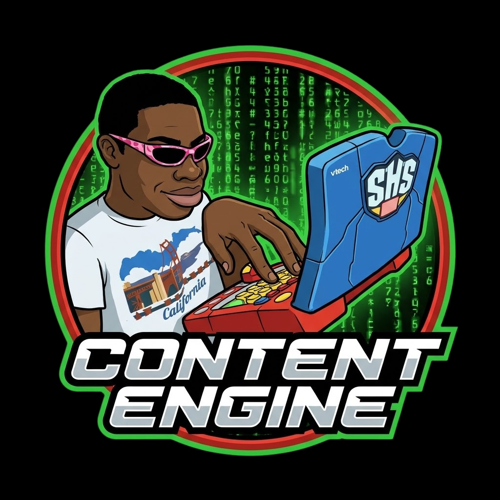
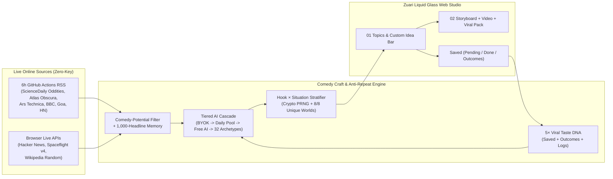

<div align="center">



# Absurd Low-Poly Content Engine

**Enterprise-grade, zero-repeat comedy ideation, storyboard, and short-form video prompt studio for 1998 PS1 / N64 ultra low-poly 3D content.**

[](https://dr-week.github.io/absurd-lowpoly-content-engine/)
[](https://github.com/dr-week/absurd-lowpoly-content-engine/actions/workflows/deploy-pages.yml)
[](https://github.com/dr-week/absurd-lowpoly-content-engine/actions/workflows/sync-trends.yml)

[](web/)
[](web/)
[](src/absurd_engine/)
[](src/absurd_engine/api.py)

[**Launch Live Web Studio**](https://dr-week.github.io/absurd-lowpoly-content-engine/) · [**Comedy Playbook**](PLAYBOOK.md) · [**Quick Start**](#-quick-start) · [**API Reference**](#-rest-api-reference)

</div>

---

## Live Studio

> **Production Web App (Zero Install, Zero API Key Required):**
> **https://dr-week.github.io/absurd-lowpoly-content-engine/**

---

## Executive Overview

**Absurd Low-Poly Content Engine** is a dual-stack creative production platform (TypeScript + SCSS Web Studio & Python FastAPI/CLI Backend) engineered to automate high-retention short-form absurdist comedy scripts in authentic **1998 PlayStation 1 / Nintendo 64** visual grammar.

Unlike static prompt templates or repetitive Mad-Libs combinators, the engine pairs **real-time global news ingestion**, **stand-up & sketch-room comedy mechanics**, **persistent anti-repetition memory**, and a **real-world viral feedback loop** to generate fresh, structurally varied, production-ready prompts on every refresh.

### Core Platform Capabilities

| Capability | Description |
| :--- | :--- |
| **Zero-Repeat Live News Engine** | Harvests fresh headlines across **10,000+ live items** (Hacker News, Spaceflight News, Wikipedia, BBC World, ScienceDaily Strange & Offbeat, Atlas Obscura, Ars Technica, Goa News) with a **1,000-headline** and **500-title** permanent never-repeat memory. |
| **Smart Comedy Headline Filter** | Automatically scores incoming news for comedic irony and rejects dry kernel/CVE patches, tragedies, and obscure encyclopedia stubs before generation. |
| **7 Laws of Comedy Craft** | Enforces **0.8s Frame-0 Pattern Interrupt**, **South Park "But / Therefore" causality**, **Setup → Assumption → Shatter**, **UCB Game of the Scene**, **Rule of Three**, **Punch-Word-Last Hindi economy (`≤ 7 words`)**, and **Shot 1 → Shot 6 Callback Loops**. |
| **Hook × Situation Taxonomy** | Categorizes and stratifies every 8-card batch across **6 Hook Categories** (`Iconic Figures`, `Over-Engineer`, `Fake Origins`, `Weird Science`, `Fake Hacks`, `Breaking Chaos`) and **6 Situation Categories** (`World & Politics`, `Goa & Travel`, `AI & Gadgets`, `Petty Ego`, `Lab & Space`, `School & Origin`) with **8/8 unique worlds** and **0 adjacent same-format cards**. |
| **Custom Idea Studio & Cast Roster** | Write any 1-line premise or click a 7-character quick-pick preset (**Elon**, **Trump**, **Gandhiji**, **Putin**, **Modi**, **Goa Uncle**, **MIT Lab**) to generate a full Storyboard, Video Prompt, and Viral Pack instantly. |
| **Viral Packaging & Series Tools** | Auto-generates **3 High-CTR Titles**, **Pinned Comment Bait**, **Loop Audit**, and **5 Precision Hashtags** alongside **1-Click Camera Rig Re-Roll**, **Punchline Lab**, **Part 2 Callback Sequels**, **Crossover Mashups**, and **Copy All**. |
| **Saved Workflow & 5× Viral Taste DNA** | Thumbs Up stores topics in **Saved** (`Pending` → `Done` when generated via `→`). Tagging posted videos as `Flop` / `Good` / `Viral` weights real viral winners **5× higher** in your live **Taste DNA** to steer future AI batches. |
| **6-Hour Automated Factory & Sync** | GitHub Actions syncs fresh oddities/world trends every 6 hours (and optionally pre-generates daily AI episodes into `daily_episodes.json`). Cross-device **Backup / Restore JSON** transfers your Saved list, outcomes, and history across devices. |

---

## System Architecture



---

## Prompt & Aesthetic Standards

All outputs strictly adhere to [PLAYBOOK.md](PLAYBOOK.md):

- **Strict Text-Only Output:** Produces copy-ready **6-Frame 3×2 Storyboard Prompts** and **6-Shot Video Prompts** only.
- **Single Global Style Header:** Declares the raw 1998 PS1/N64 low-poly geometry, blurry bitmap textures, crude Gouraud shading, randomized 1998 camera/lighting rig, and negative constraints (`NO 2D cartoon art, NO comic ink outlines, NO cel-shading, NO smooth modern CGI`) **once** in the header—eliminating token bloat across individual shots.
- **Zero Time or Aspect-Ratio Leaks:** Video prompts never mention duration (`20-second`), aspect ratio (`9:16`), or timestamps (`[0:00–0:03]`).
- **Lo-Fi 1998 Audio Grammar:** Specifies slightly compressed lo-fi 1998 PS1-era deadpan Indian male narrator fidelity paired with retro SFX and sharp hard cuts.

---

## Quick Start

### 1. Zero-Install Web Studio (Recommended)
Open **[https://dr-week.github.io/absurd-lowpoly-content-engine/](https://dr-week.github.io/absurd-lowpoly-content-engine/)**:
- Press **`R`** (or click Refresh) for 8 brand-new live-news topics.
- Press **`1`–`8`** (or click **`→`**) to generate the Storyboard, Video Prompt, and Viral Pack.
- Optional: Open **Settings** to paste a free **Gemini**, **Groq**, or **OpenRouter** API key for unlimited zero-cooldown LLM generation, or export/restore a cross-device **Backup JSON**.

### 2. Local Web Studio Development
```bash
cd web
npm install
npm run test:harness   # 120-card F5 reload, 0/32 rapid live repeat, Comedy Craft & Saved tests
npm run build          # TypeScript type-check + Vite production bundle
npm run dev            # Local Vite dev server
```

### 3. Python CLI, FastAPI Backend & Log Optimizer
```bash
# Install Python dependencies
uv sync --extra dev

# Run backend test suite
uv run pytest -v

# Generate a full episode via CLI
uv run absurd generate --topic "Goa beach sunset server update"

# Start FastAPI server (OpenAPI docs at /docs)
uv run absurd serve --port 8000

# Tune the 6-hour AI Episode Factory from exported Studio logs or Backup JSON
uv run python scripts/optimize_from_logs.py absurd-studio-backup.json
```

### 4. Optional — Activate 6-Hour Automated AI Episode Drops
Add a free `GEMINI_API_KEY` or `GROQ_API_KEY` under your repository's **Settings → Secrets and variables → Actions**. The scheduled [sync-trends.yml](.github/workflows/sync-trends.yml) workflow will automatically pre-generate fresh AI episodes into `web/public/daily_episodes.json` every 6 hours for 0ms, zero-cooldown delivery.

---

## REST API Reference

When running `uv run absurd serve --port 8000`:

| Endpoint | Method | Description |
| :--- | :---: | :--- |
| `/health` | `GET` | Engine status, active LLM provider, and model configuration |
| `/ideas/generate` | `POST` | Generate 1–5 comedy-crafted premises with anti-cliché rules |
| `/storyboards/generate` | `POST` | Expand a premise into a 6-frame 3×2 storyboard spec and prompt |
| `/videos/generate` | `POST` | Expand a premise into a 6-shot video script and rendered prompt |
| `/episodes/generate` | `POST` | Full fused pipeline (`idea → storyboard → video → lint`) with optional SQLite & disk export |
| `/lint` | `POST` | Validate any episode bundle against Playbook quality rules |

Configure any provider via `.env` (see [.env.example](.env.example)): `gemini`, `groq`, `openrouter`, `openai`, `anthropic`, `ollama`, or `mock`.

---

## Modular Repository Structure

Every frontend module is strictly maintained under **150 lines** for clarity, testability, and rapid iteration.

```text
absurd-lowpoly-content-engine/
├── assets/                     # Brand assets (Content Engine emblem)
├── scripts/
│   ├── sync_trends.py          # 6-hour global/oddities/Goa RSS aggregator
│   ├── generate_daily_pool.py  # Optional 6-hour AI episode pre-generator
│   └── optimize_from_logs.py   # Taste DNA optimizer from exported logs/backups
├── src/absurd_engine/          # Python FastAPI backend, Typer CLI, LLM providers & linter
├── tests/                      # Python pytest verification suite (12 tests)
└── web/                        # TypeScript + SCSS Zuari Liquid Glass Web Studio
    ├── public/                 # Live synced trends & daily episode feeds
    ├── src/
    │   ├── data/               # 36 bespoke stories, 32 live archetypes, character roster
    │   ├── engine/             # Live news, comedy craft, taxonomy, Taste DNA, sequels, mashups
    │   ├── styles/             # Zuari OKLCH tokens, Liquid Glass surfaces, 5-plane layout
    │   └── ui/                 # Studio, Saved, Viral Analytics, Logs, Custom Bar & Shell views
    └── tests/harness.ts        # Automated 120-card F5 reload & anti-pattern verification harness
```

---

## Quality & Verification Guarantees

- **Automated Web Harness (`npm run test:harness`):** Verifies 15 simulated F5 reloads × 8 cards (`6/6` formats, `8/8` unique worlds, `0` adjacent same-format cards, `0/8` consecutive repeats), `0/32` repeats across 4 rapid live refreshes, Headline Filter, Taste DNA 5× Viral weighting, Part 2 Sequels, Crossover Mashups, Custom Ideas, Viral Pack, Camera/Punchline tools, Saved lifecycle, and Backup/Restore.
- **Automated Python Suite (`uv run pytest -v`):** Verifies fused pipeline, linter scoring, RSS parsing, mechanic rotation, SQLite history, token savings benchmarks, and FastAPI endpoints.

---

<div align="center">

Built with precision by **DCODE / Content Engine** · [Open Live Studio](https://dr-week.github.io/absurd-lowpoly-content-engine/)

</div>

## Liquid Glass Workspaces: AI Chat, Studio & Stage

- **Dedicated AI Chat Menu (`Chat` Workspace — `web/src/ui/chat_view.ts` & `web/src/engine/chat/chat_engine.ts`)**: Full 2-column Liquid Glass AI Writers' Room with persistent IndexedDB thread history (`threads` store + `BroadcastChannel` multi-tab sync), quick-action slash chips (`/ 5-Beat Script`, `/ Hinglish Pass`, `/ Punch Up Twist`, `/ 3 Hooks`), Free AI + BYOK + offline fallback, and 1-click **`Send to Studio`** / **`Open in Stage`** handoffs on every reply.
- **Prompt Studio (`Studio` Workspace — `web/src/ui/studio_view.ts`)**: Focused 3-step visual production flow (`01 Topics` -> `02 3x2 Storyboard & Video Prompts` -> `03 Growth, Overlays & Captions`) with 1-click handoffs back to **Chat** and **Stage**.
- **Rehearsal Stage (`Stage` Workspace — `web/src/ui/script_chat_section.ts`)**: Dedicated 60/40 split pane for the 5-Beat Retention Script Compiler (~2.3 words/sec pacing timeline, cue chips, Clean/Rehearsal/JSON copy modes), WPM mirror teleprompter with glowing eyeline, 9:16 safe-zone HUD overlays (`Reels`, `TikTok`, `Shorts`), and Local IndexedDB Vault.
- **Local-First Storage (`web/src/engine/storage/`)**: IndexedDB (`absurd_script_studio_v1` v2), AES-256-GCM encrypted vault (`crypto_vault.ts` + `sessionStorage`), and `navigator.storage.persist()` profile management.
